# 🎸 AI Stompbox & Native Instrument Vault (`ai-stompbox-library`)

> **专为 AI Agent 编曲、程序化音乐生成与高保真离线混音打造的“按项目克隆（Copy-on-Use）”硬件建模单块效果器板、录音室多采样原生器乐库与全自动混音母带工作站。**

---

## 💡 为什么要做这个项目？（设计初衷与行业痛点）

当我们使用 AI Agent（或 Python 脚本）进行音乐编曲、MIDI 渲染与后期混音时，现有的工具链往往卡在三个断层上：
1. **纯数学振荡器合成太“假”**：直接用正弦波/锯齿波拼凑出的吉他或鼓点缺乏真实拨片触弦瞬态、木质琴体共鸣与真鼓皮泛音，听感廉价。
2. **传统 C++ 音频库（如 Spotify `pedalboard`、`pyo`）是“预编译黑盒”**：
   - 存在跨平台编译/Wheel 缺失问题；
   - **无法按单曲魔改内部电路**：在制作不同风格的歌曲时，你很难让 AI 直接点开某个合唱或法兹单块的源码，去把对称削波改成非对称电子管偶次谐波削波；
   - **不含原生器乐声源与多轨混音台**：只有零散的效果器，缺少开箱即用的真实采样乐器与自动分频闪避混音台。
3. **AI Agent 调用外部库时的“分析地狱（Analyze Hell）”**：如果库文件分散且没有统一签名契约，AI 每次写歌前都要耗费大量时间与 Token 去逐个 `read_file` 查看每个效果器类的参数名（到底叫 `decay` 还是 `decay_sec`？叫 `rate` 还是 `rate_hz`？）。

---

## ✨ 四大核心优势

### 1. Copy-on-Use（母库只读 · 按项目克隆独立改参）
- **核心哲学**：母库（`ai_stompbox_library`）永远保持纯净只读；每当开始制作一首新歌时，通过 `clone_rig.py` 将单块脚本（`stomp_*.py`）与器乐引擎（`native_instruments.py`）一键复制到该歌曲项目的本地子目录（如 `<song_dir>/fx_rig/`）。
- **单曲深度定制**：AI 或开发者可以直接在歌曲本地的 `fx_rig/` 里任意调整参数、修改滤波器斜率甚至重写某个单块的非线性失真方程，**不同歌曲之间完全隔离，绝不污染母库**。

### 2. No-Analyze 零读取盲调架构（AI Agent 原生友好）
- **单行总入口 (`from stomp_hub import *`)**：通过 [`pedals/stomp_hub.py`](pedals/stomp_hub.py) 将全部 **43 个单块/混音台类** 与 **原生器乐引擎** 聚合为单一命名空间，AI 无需关心某个单块在哪个分类文件。
- **100% 确定性参数契约**：所有单块统一遵循 `Pedal(param1=..., mix=1.0, level=1.0, bypass=False)` 契约，配合配套的 `SKILL.md` 精确签名表，AI Agent **0 次源码读取（Zero `read_file`）即可一次性盲写完整的单块串联与母带工程**。

### 3. “真实多采样声源 → 硬件单块踏板 → 录音室混音台”全链路纯 Python 闭环
- **零编译依赖**：底层仅依赖科学计算标准库 `NumPy + SciPy`，任何 Python 环境开箱即跑。
- **内置 91 个 44.1kHz Stereo 录音室实录采样根音 (`sample_vault/`)**：涵盖 **16 种原生旋律器乐**（木吉他、古典吉他、爵士/清音/过载/失真电吉他、三角钢琴、Rhodes 电钢琴、木贝斯、指弹电贝斯、小提琴、大提琴、交响弦乐群、竖琴、长笛、颤音琴）与 **10 种真鼓 + TR-808 采样**，支持 `0–127` 全 MIDI 音域自动最近根音变调插值与技法包络（`normal` / `swell` 慢门渐强 / `staccato` 断奏 / `vibrato_cents` 揉弦）。

### 4. 真实硬件电路顺序与物理声学细节建模
- **解决数字失真“刺耳发毛”问题**：真实电吉他失真必须经过吉他音箱喇叭（如 Celestion Greenback 或 Roland JC-120 银盆喇叭）在 `4.5 kHz` 以上的陡峭物理滚降。本库内置 6 种箱体/琴体共鸣模拟（`CabinetSimulatorIR`），将失真严密包裹在中频甜区。
- **纯正 Shoegaze / Dream Pop “失真混响（Distorted Reverb）”信号流**：支持将**反向早期反射混响（`ReverseReverbMBV`）置于法兹/过载（`BigMuffPiFuzz`）之前**，让混响尾音本身被晶体管/电子管放大器压缩并产生偶次谐波饱和，复刻 My Bloody Valentine、Slowdive 与 Cocteau Twins 标志性的“融化在浓雾里的音墙”。

---

## 🔄 核心使用逻辑与四步工作流

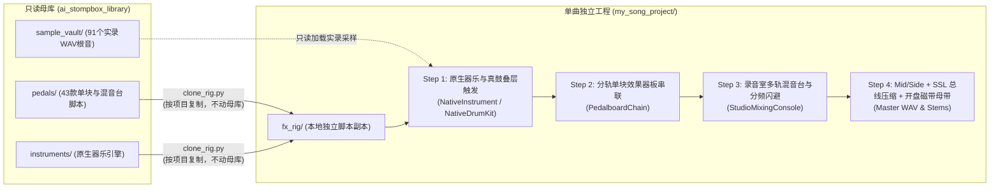

### Step 1：克隆效果器与器乐脚本到新歌曲目录
每当新建一个音乐工程，先将全套单块复制到该工程的 `fx_rig` 目录：
```bash
python clone_rig.py --target "./my_new_song/fx_rig" --modules all
```

### Step 2：一行导入 + 原生器乐多采样叠层触发（Source Layering）
在你的歌曲渲染脚本中，通过 `from stomp_hub import *` 导入全部能力，并用多采样叠层构建饱满的干声：
```python
import sys

sys.path.insert(0, "./my_new_song/fx_rig")
from stomp_hub import *

# 示例：75% 爵士电吉他 (温润中频) + 25% 民谣钢弦木吉他 (补充真实拨片擦弦瞬态)
gtr_jazz = NativeInstrument("electric_guitar_jazz")
gtr_steel = NativeInstrument("acoustic_guitar_steel")

note_jz = gtr_jazz.render_note(
    midi_pitch=64, duration_sec=2.0, velocity=0.88, pan=-0.28, vibrato_cents=8.0
)
note_st = gtr_steel.render_note(
    midi_pitch=64, duration_sec=2.0, velocity=0.88, pan=-0.28
)
dry_guitar = 0.75 * note_jz + 0.25 * note_st
```

### Step 3：像真实单块踏板一样串联分轨效果器板（Pedalboard Chaining）
每个分轨都可以挂载独立的 `PedalboardChain`，信号按列表顺序从左到右依次流经每颗单块：
```python
# 经典 Dream Pop 清音节奏吉他链：MXR 压缩 -> 透明微过载 -> JC-120 箱头 -> 四键空间合唱 -> 大教堂微光混响
rhythm_board = PedalboardChain([
    DynaCompPedal(sensitivity=0.62, makeup_db=4.0),
    BluesbreakerDrive(drive=0.28, tone=0.65, mix=0.55),
    RolandJC120Amp(bright=True, bass_db=1.5, mid_db=-1.0, treble_db=2.5),
    DimensionCChorus(mode=3, mix=0.52),
    CathedralShimmerReverb(decay_sec=3.4, shimmer=0.15, mix=0.38),
])
wet_rhythm_guitar = rhythm_board(dry_guitar)
```

### Step 4：多轨自动混音台、分频侧链闪避与母带总线（Mixing & Mastering）
使用 `StudioMixingConsole` 完成各分轨推子平衡、高低切、**底鼓触发贝斯 `<180 Hz` 分频动态闪避**以及母带胶水压限：
```python
console = StudioMixingConsole(target_rms_dbfs=-10.8, ceiling_peak=0.96)

# 1. 各轨道推子 (fader_db)、声像 (pan) 与通道滤波雕刻 (hpf_hz / lpf_hz)
console.add_track(
    "drums", buf_drums, fader_db=0.0, pan=0.0, hpf_hz=25.0
)  # 鼓组居中
console.add_track(
    "bass", buf_bass, fader_db=-1.5, pan=0.0, hpf_hz=32.0, lpf_hz=3200.0
)  # 贝斯居中并切掉 3.2kHz 以上毛刺
console.add_track(
    "gtr_rhythm",
    wet_rhythm_guitar,
    fader_db=-2.2,
    pan=-0.28,
    hpf_hz=85.0,
    lpf_hz=5200.0,
)  # 吉他切掉 85Hz 以下让给底鼓贝斯

# 2. 真实音频触发的分频侧链闪避：底鼓踩下时，仅闪避贝斯 180Hz 以下超低频，保留贝斯拨弦音头！
console.apply_sidechain_ducking(
    target_track="bass",
    trigger_track="drums",
    threshold_db=-22.0,
    duck_depth=0.50,
    crossover_hz=180.0,
)

# 3. 母带总线串联：微笑除泥均衡 -> Mid/Side 声场拓宽与低频单声道锁定 -> SSL 总线胶水压缩 -> Studer 开盘磁带机 -> 三段限制器
master_audio = console.render_master(
    master_chain=PedalboardChain([
        StudioParametricEQ(
            hpf_hz=30.0,
            low_db=1.2,
            mid_hz=420.0,
            mid_db=-1.2,
            high_db=1.5,
            lpf_hz=16500.0,
        ),
        MidSideProcessorPedal(
            mid_gain_db=0.0,
            side_gain_db=1.6,
            side_air_db=1.8,
            mono_below_hz=130.0,
        ),
        SSLBusGlueCompressor(
            threshold_db=-12.0, ratio=4.0, sc_hpf_hz=90.0, makeup_db=2.0
        ),
        ReelToReelTapeMaster(
            drive=1.18, head_bump_db=1.8, wow_depth_ms=0.2, tape_hiss=0.0003
        ),
        MultibandLimiter3Band(
            low_xover_hz=180.0,
            high_xover_hz=3800.0,
            drive=1.12,
            ceiling_peak=0.96,
        ),
    ])
)
```


---

## 📸 建模原型：经典硬件单块、音箱与鼓机实拍图鉴

> 以下实拍照片均取自 Wikimedia Commons / Wikipedia 开源硬件图库，对应本库 `pedals/` 中的核心数字信号处理（DSP）建模模块：

| 硬件实拍图 | 对应本库单块类 (`stomp_hub`) | 核心电路与物理声学特性建模 |
| :---: | :--- | :--- |
| 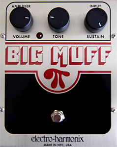 | **`BigMuffPiFuzz`** / **`ShoegazeDistortedReverb`**<br>(`stomp_drive_fuzz.py` / `stomp_reverb.py`) | Electro-Harmonix Big Muff Pi 四级级联晶体管削波 + 标志性中频凹陷 Tone Stack，搭配前置反向混响构成纯正盯鞋（Shoegaze）失真混响音墙 |
| 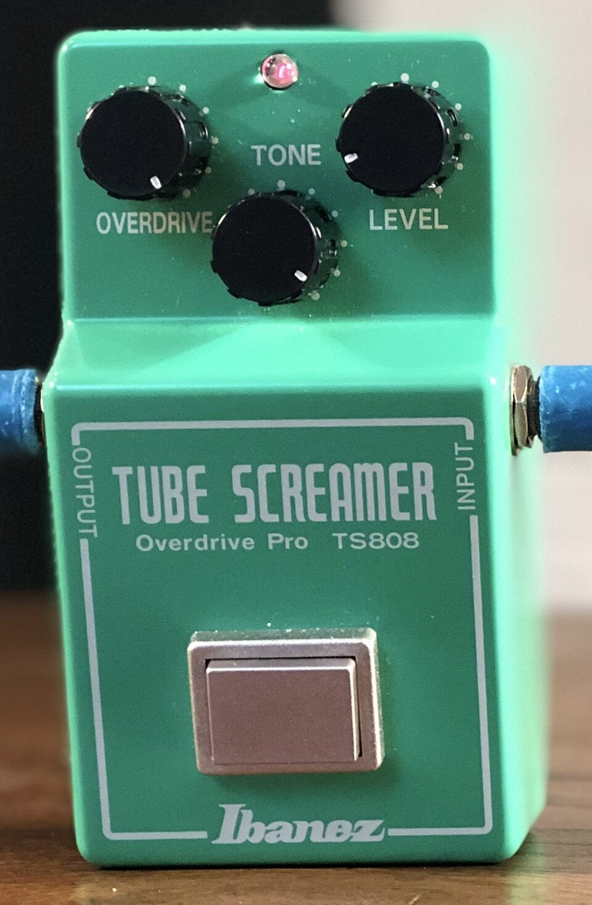 | **`TubeScreamerTS808`**<br>(`stomp_drive_fuzz.py`) | Ibanez TS-808 经典 `720 Hz` 中频凸起（Mid-Hump）高通网络与运算放大器反馈回路非对称硅二极管软削波 |
| 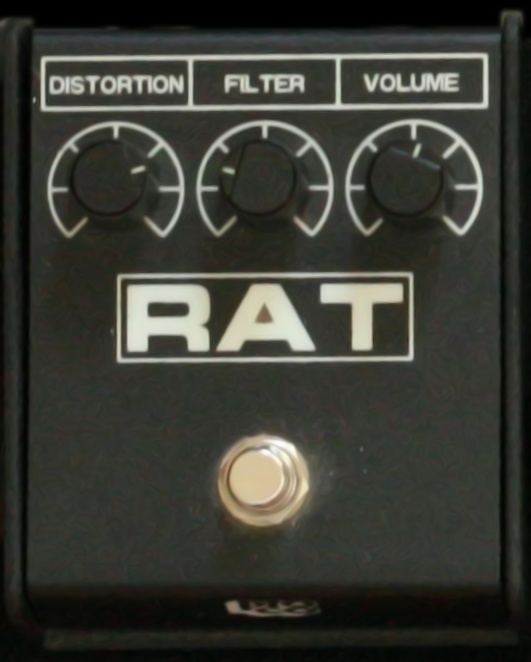 | **`ProCoRatDistortion`**<br>(`stomp_drive_fuzz.py`) | ProCo RAT LM308 运算放大器压摆率（Slew-Rate）硬削波失真 + 反向高切 Filter 旋钮 |
| 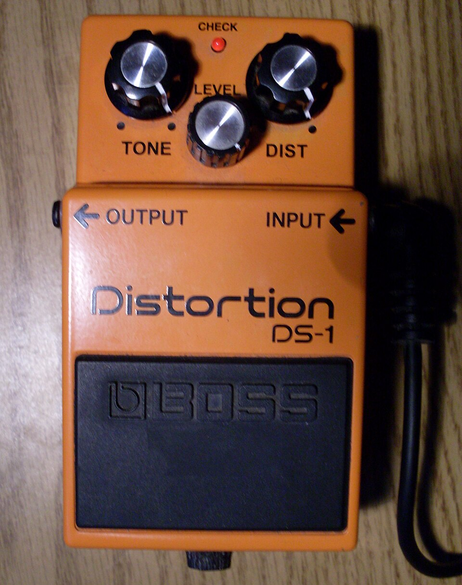 | **`BossCE2Chorus`** / **`DimensionCChorus`** / **`PitchVibratoVB2`**<br>(`stomp_modulation.py`) | Boss / Roland 经典 BBD（Bucket-Brigade Device）模拟延迟线正交 LFO 调制立体声合唱与摇把纯音高颤音 |
| 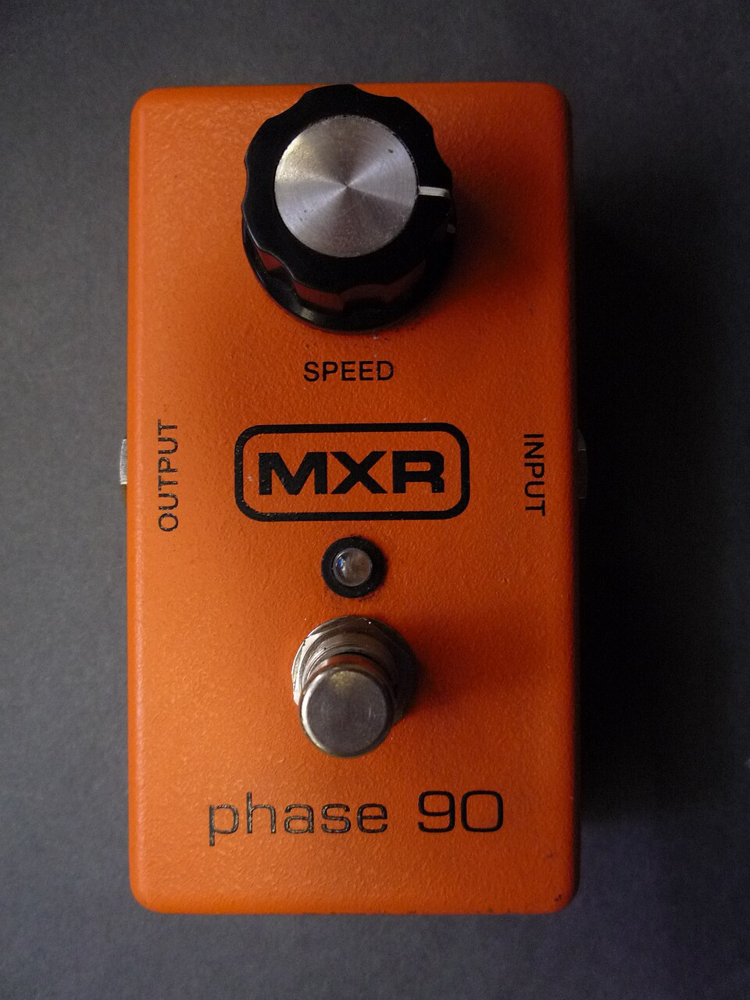 | **`Phase90Phaser`** / **`DynaCompPedal`**<br>(`stomp_modulation.py` / `stomp_dynamics.py`) | MXR M-101 Phase 90 扫频全通移相器与 Dyna Comp 高灵敏度颗粒感压缩 |
| 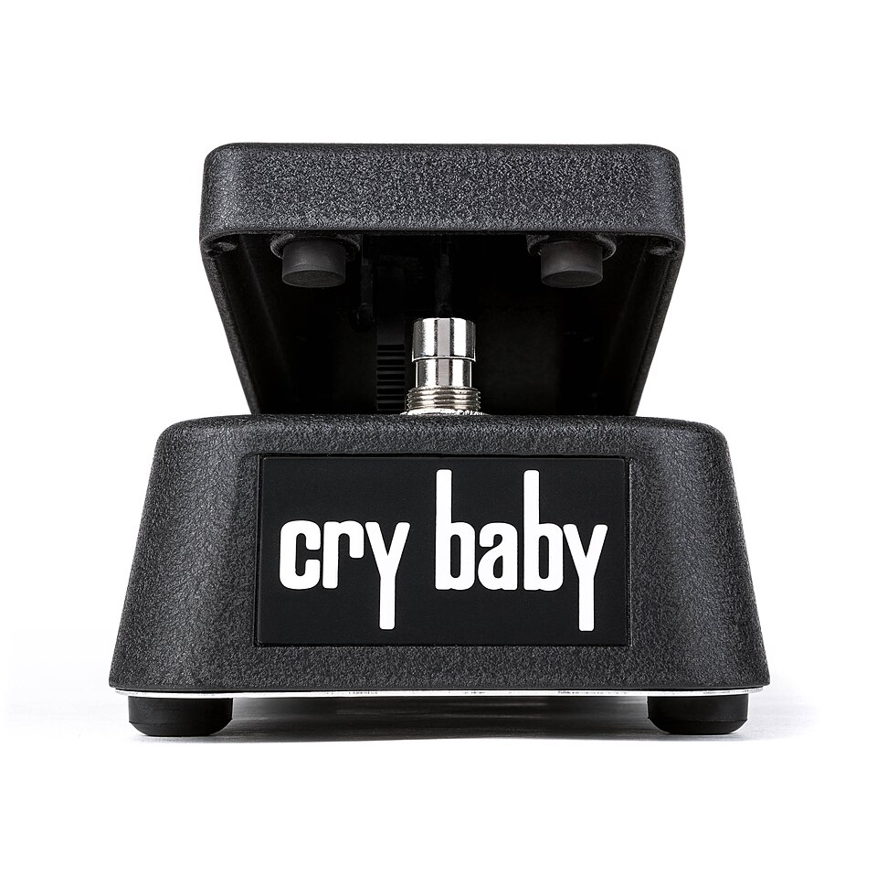 | **`CryBabyAutoWah`**<br>(`stomp_filter_eq.py`) | Dunlop CryBaby 经典高 Q 值谐振峰带通扫频哇音与动态包络跟随自动哇音 |
| 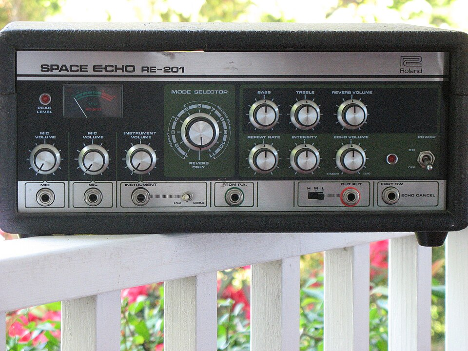 | **`SpaceEchoRE201`**<br>(`stomp_delay.py`) | Roland RE-201 Space Echo 三磁头（`1x / 1.75x / 2.5x`）循环磁带回声，含磁带饱和、高低频自然衰减与 Wow/Flutter 机械抖动 |
| 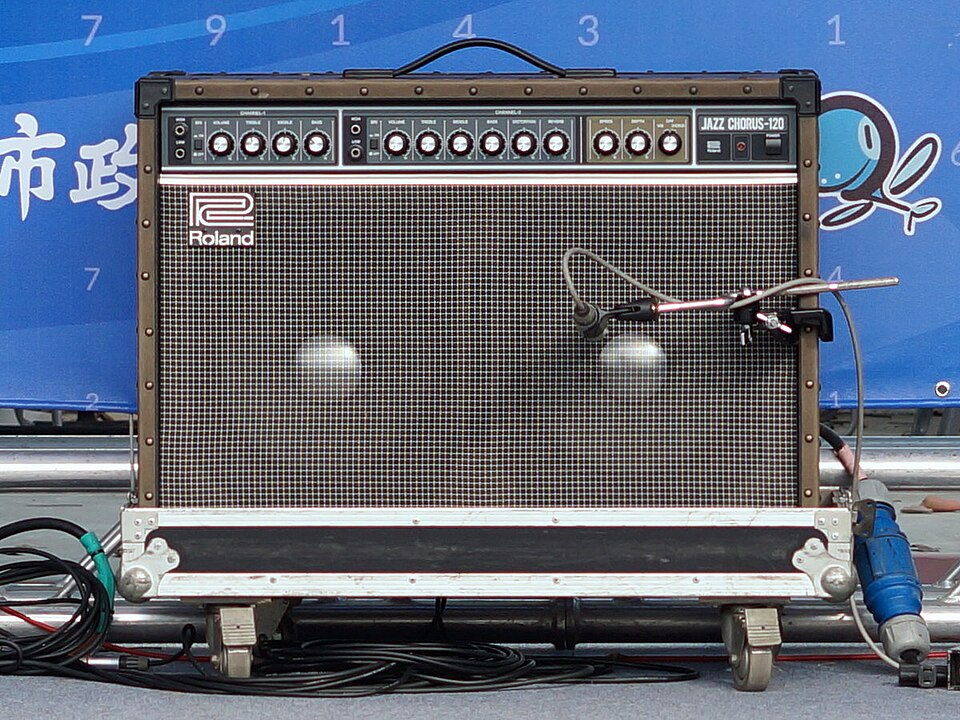 | **`RolandJC120Amp`** + **`CabinetSimulatorIR("2x12_JC120")`**<br>(`stomp_amp_cab.py`) | Roland JC-120 Jazz Chorus 晶体管高动态清音箱头、Bright 亮音开关与 2x12 银盆喇叭箱体模拟（Dream Pop 标准清音底座） |
| 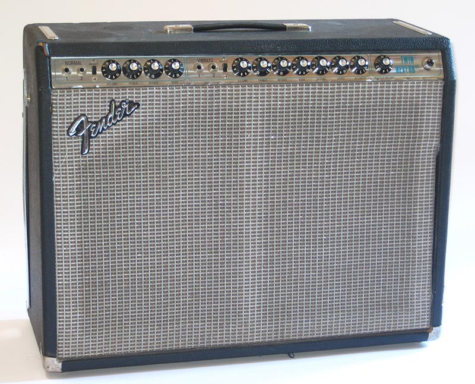 | **`FenderTwinAmp`** + **`FenderSpringReverb`**<br>(`stomp_amp_cab.py` / `stomp_reverb.py`) | Fender '65 Twin Reverb Blackface 中频凹陷电子管清音与 '63 弹簧混响盒高频啾鸣色散（Chirp Dispersion）建模 |
| 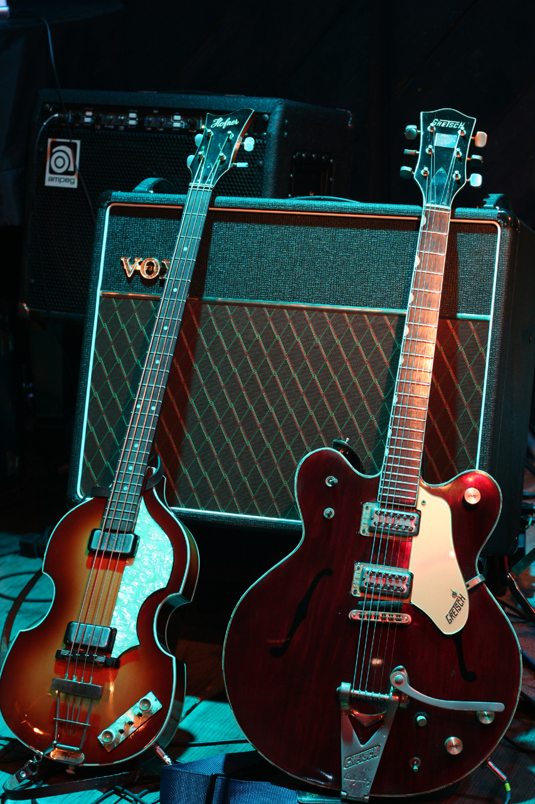 | **`VoxAC30TopBoost`** + **`CabinetSimulatorIR("2x12_Celestion_Blue")`**<br>(`stomp_amp_cab.py`) | Vox AC30 甲类阴极偏置闪烁英式清音/微过载、Top Boost 高频切角（Cut Knob）与 Celestion Blue 喇叭频响 |
| 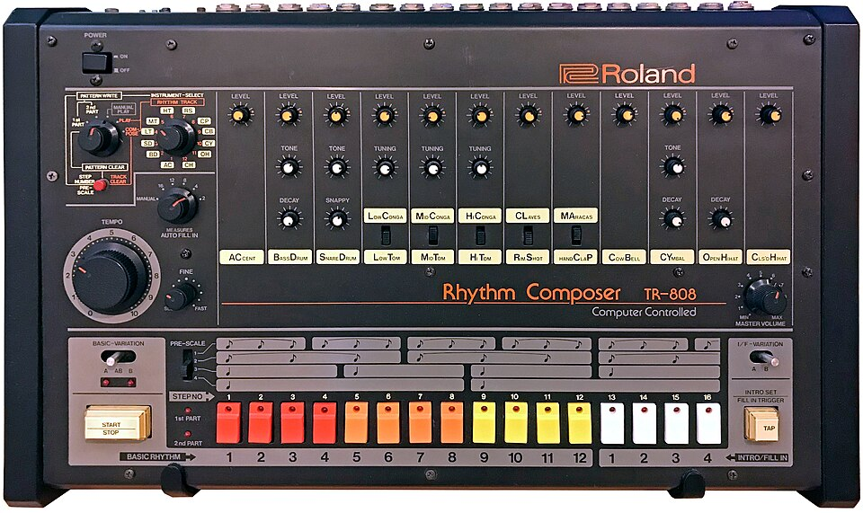 | **`NativeDrumKit`** (`kick_808`, `snare_808`, `rimshot`, `hat_closed`, `hat_open`)<br>(`instruments/native_instruments.py`) | Roland TR-808 经典模拟硬件鼓机实录采样与真实原声 Breakbeat 鼓组叠层触发器 |

---

## 🗂️ 全量模块与音色目录速查

### 一、 9 大效果器与混音台模块（共 43 个类，`pedals/`）

| 模块文件 | 包含的单块 / 混音组件 | 典型应用场景 |
| :--- | :--- | :--- |
| **[`stomp_dynamics.py`](pedals/stomp_dynamics.py)** | `DynaCompPedal`, `OpticalLA2APedal`, `NoiseGatePedal`, `TransientDesignerPedal`, `SidechainPumperPedal` | 吉他拨片颗粒压缩、贝斯/人声平滑稳压、真鼓瞬态提亮、节奏型呼吸抽吸 |
| **[`stomp_drive_fuzz.py`](pedals/stomp_drive_fuzz.py)** | `TubeScreamerTS808`, `BluesbreakerDrive`, `ProCoRatDistortion`, `BigMuffPiFuzz`, `OctaviaFuzz`, `LoFiBitcrusher` | 蓝调/独立摇滚透明过载、中频突出 Solo 推子、盯鞋摇滚浓密法兹音墙、复古 8-bit 破碎 |
| **[`stomp_amp_cab.py`](pedals/stomp_amp_cab.py)** | `RolandJC120Amp`, `FenderTwinAmp`, `VoxAC30TopBoost`, `CabinetSimulatorIR` (内置 6 款箱体/琴体模型) | 为电吉他/电贝斯/木吉他赋予真实音箱前级染色、喇叭高频滚降与木质箱体共鸣 |
| **[`stomp_modulation.py`](pedals/stomp_modulation.py)** | `BossCE2Chorus`, `DimensionCChorus`, `PitchVibratoVB2`, `Phase90Phaser`, `ElectricMistressFlanger`, `OpticalTremolo` | 80s/90s Dream Pop 立体声合唱、Jazzmaster 摇把微醺音高漂移、迷幻移相与镶边 |
| **[`stomp_filter_eq.py`](pedals/stomp_filter_eq.py)** | `CryBabyAutoWah`, `MoogLadderFilter`, `SmokyBubbleFilter`, `StudioParametricEQ`, `LoFiRadioTelephone` | 水下 24dB 阶梯低通滤波、砂原良徳式液体气泡共振调制、四段精准参数均衡、复古电话音色 |
| **[`stomp_delay.py`](pedals/stomp_delay.py)** | `AnalogBBDDelay`, `SpaceEchoRE201`, `PingPongStereoDelay`, `ReverseDelay` | 附点八分立体声乒乓延迟、温暖暗音色模拟回声、三磁头磁带回声、迷幻反向颗粒回声 |
| **[`stomp_reverb.py`](pedals/stomp_reverb.py)** | `FenderSpringReverb`, `EMT140PlateReverb`, `CathedralShimmerReverb`, `ReverseReverbMBV`, `ShoegazeDistortedReverb`, `GatedReverb80s` | 冲浪摇滚弹簧混响、军鼓/人声板式混响、八度微光大教堂混响、MBV 前置反向混响、失真混响音墙一体机 |
| **[`stomp_pitch_master.py`](pedals/stomp_pitch_master.py)** | `PolyOctavePOG`, `MicroPitchDetune`, `ReelToReelTapeMaster` | 十二弦/管风琴式上下八度复音叠音、Eventide 双声道微音高加厚、Studer 开盘母带磁带机 |
| **[`stomp_mixer_console.py`](pedals/stomp_mixer_console.py)** | `AudioTriggeredSidechainDucker`, `MidSideProcessorPedal`, `SSLBusGlueCompressor`, `MultibandLimiter3Band`, `StudioMixingConsole` | 底鼓触发贝斯 `<180Hz` 分频动态闪避、Mid/Side 声场拓宽与低频单声道锁定、SSL 总线胶水压缩、多轨自动混音与响度对齐 |

### 二、 16 种原生旋律器乐 + 10 种真鼓/808 采样（`instruments/` + `sample_vault/`）

| 器乐分类 | `NativeInstrument` / `NativeDrumKit` 精确调用名 |
| :--- | :--- |
| **原生木吉他与拨弦** | `"acoustic_guitar_nylon"` (古典尼龙弦), `"acoustic_guitar_steel"` (民谣钢弦), `"orchestral_harp"` (交响竖琴) |
| **原生电吉他** | `"electric_guitar_jazz"` (Jazzmaster/ES 爵士清音), `"electric_guitar_clean"` (Strat/Tele 清音), `"overdriven_guitar"` (过载), `"distortion_guitar"` (失真) |
| **原生键盘与击弦** | `"acoustic_grand_piano"` (原声三角钢琴), `"electric_piano_1"` (Fender Rhodes 电钢琴), `"vibraphone"` (原声颤音琴) |
| **原生贝斯** | `"acoustic_bass"` (原声木贝斯/低音提琴拨弦), `"electric_bass_finger"` (指弹电贝斯) |
| **原生弓弦与管乐** | `"violin"` (独奏小提琴), `"cello"` (独奏大提琴), `"string_ensemble_1"` (交响弦乐群), `"flute"` (原声长笛) |
| **原声真鼓与 808 鼓机** | `"kick_acoustic"`, `"kick_808"`, `"snare_acoustic"`, `"snare_808"`, `"snare_ghost"`, `"rimshot"`, `"hat_closed"`, `"hat_open"`, `"clap_808"`, `"tom_low"` |

---

## 🎧 完整实战案例：《Smoky Bubble Dream Pop》全链路拆解

仓库 [`examples/smoky_bubble_dreampop/`](examples/smoky_bubble_dreampop/) 完整收录了一首参考 **電気グルーヴ（Denki Groove）《SMOKY BUBBLES》（石野卓球 & 砂原良徳，1997 专辑《A》）** 氛围质感的 **98 BPM、E Lydian 调式（`Emaj9 -> F#6/9 -> D#m11 -> G#m9`）** Dream Pop 作品：

- **🎵 成品试听与下载**：
  - 无损母带 WAV：[`examples/smoky_bubble_dreampop/smoky_bubble_STOMPBOX_SKILL_MASTER.wav`](examples/smoky_bubble_dreampop/smoky_bubble_STOMPBOX_SKILL_MASTER.wav)
  - 320kbps 母带 MP3：[`examples/smoky_bubble_dreampop/smoky_bubble_STOMPBOX_SKILL_MASTER.mp3`](examples/smoky_bubble_dreampop/smoky_bubble_STOMPBOX_SKILL_MASTER.mp3)
  - 7 条独立单块渲染分轨（MP3）：[`examples/smoky_bubble_dreampop/audio_stems_mp3/`](examples/smoky_bubble_dreampop/audio_stems_mp3/)
  - 多轨合并与单轨 MIDI：[`examples/smoky_bubble_dreampop/midi/`](examples/smoky_bubble_dreampop/midi/)
- **📜 核心工程脚本**：
  - 编曲与人性化扫弦/摇摆律动生成：[`examples/smoky_bubble_dreampop/composition.py`](examples/smoky_bubble_dreampop/composition.py)
  - 单块串联与分轨混音母带主脚本：[`examples/smoky_bubble_dreampop/render_via_stompbox_skill.py`](examples/smoky_bubble_dreampop/render_via_stompbox_skill.py)
  - DAW 宿主导入指南：[`examples/smoky_bubble_dreampop/README_DAW_GUIDE.md`](examples/smoky_bubble_dreampop/README_DAW_GUIDE.md)
